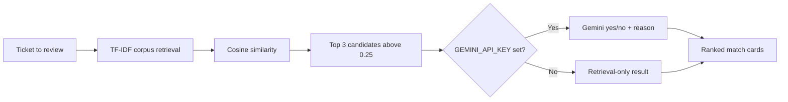

# Duplicate Ticket AI

Duplicate Ticket AI is a small support-operations product demo that finds likely duplicate support tickets. It ranks tickets in the local corpus with explainable TF-IDF cosine similarity, then can ask Gemini to confirm whether the highest-scoring candidates describe the same underlying issue.

The sample workspace, **Harbor Desk**, contains ten fictional English tickets. There are no real customers or support records.

## How the AI works



The retriever tokenizes the subject and body, weights terms with corpus IDF, and ranks candidates by cosine similarity. It returns at most three candidates above `0.25`. The candidate score is always the retrieval score; an LLM confirmation is a separate yes/no signal with a short reason, not a replacement ranking or an automatic ticket action. Provider errors/timeouts keep the retrieval results and return an unconfirmed status.

## Run locally without an API key

Requirements: PHP 8.3+, Composer, Node.js 22+, and npm.

```bash
composer setup
php artisan db:seed
composer dev
```

Open the local URL printed by Laravel. The app uses SQLite by default. **No Gemini key is required**: without `GEMINI_API_KEY`, it runs TF-IDF retrieval only and labels candidates as unconfirmed. The seeded Harbor Desk tickets are ready to explore; no demo login is needed.

To enable optional Gemini confirmation, add a key to `.env`:

```dotenv
GEMINI_API_KEY=your-key
GEMINI_MODEL=gemini-2.0-flash
```

Gemini requests have a 12-second timeout. Keep the key private and out of source control.

## Tests and quality checks

```bash
php artisan test
vendor/bin/phpstan analyse --memory-limit=512M
npm run check
npm run types:check
npm run build
```

The Pest suite exercises real TF-IDF ranking (the checkout-tax pair must rank first), a unique-ticket no-match case, explicit binding of `FakeLlmClient`, guest access to the POST flow, and graceful retrieval fallback when an LLM provider fails. Tests use SQLite in memory and never make external model calls.

## Architecture

```text
app/
├── Http/Controllers/TicketController.php   # Inertia page and guest analysis endpoint
├── Models/                                  # SupportTicket, DuplicateCheck, DuplicateMatch
└── Services/
    ├── Llm/                                 # LlmClient, Gemini, retrieval-only, and test fake
    └── Tickets/DuplicateFinder.php          # TF-IDF corpus scoring and match persistence
resources/js/pages/Tickets/Index.vue          # Vue ticket queue and ranked match cards
database/seeders/DatabaseSeeder.php           # Ten fictional Harbor Desk tickets
```

`LlmClient` is the boundary around model calls. The service provider selects Gemini only when a key is configured; otherwise it selects a retrieval-only implementation. This keeps the product available offline and lets tests inject a deterministic fake.

## Data model

- `SupportTicket`: subject, body, and `open` / `closed` status.
- `DuplicateCheck`: one completed analysis for a source ticket.
- `DuplicateMatch`: candidate ticket, cosine score, LLM confirmation flag, and JSON reasons.

The app is an unauthenticated demo. Do not put private support content or credentials into the sample workspace.
